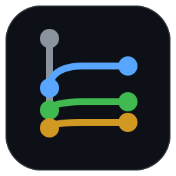
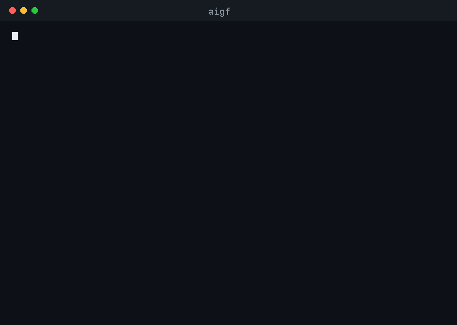

<p align="center">
  <a href="https://github.com/wildkodokushi/AI-Git-Flow-CLI/blob/main/README.md">Русский</a> &nbsp;·&nbsp; <b>English</b>
</p>

<p align="center">
  
</p>

<h1 align="center">AI Git Flow CLI</h1>

<p align="center">
  Git assistant powered by language models: grouped commits, branches, pull requests, README, LICENSE and issues
</p>

<p align="center">
  <a href="https://www.npmjs.com/package/ai-git-flow"></a>
  <a href="https://www.npmjs.com/package/ai-git-flow"></a>
  <a href="https://github.com/wildkodokushi/AI-Git-Flow-CLI/actions/workflows/ci.yml"></a>
  
  
  
  
</p>

<p align="center">
  
</p>

```bash
npx ai-git-flow init    # setup: provider, key, model check
aigf                    # branch, commits, push and pull request
```

`aigf` and `ai-git-flow` are the same command. Examples below use `aigf`.

> A Windows PowerShell version is in [AI-Git-Flow](https://github.com/wildkodokushi/AI-Git-Flow) (command `aiflow`). Both can live on one machine.

**Language.** The interface follows your system locale. Switch with `--ui-lang en|ru`, the `AIGF_UI_LANG` variable or `aigf config set uiLang en`. Generated texts (commits, PR, README, issues) follow `--lang`.

> Translation status: help, commit and pull request messages are in English. The `init` wizard, `doctor`, `license`, `readme`, `issue`, `provider`, `config` and error messages are still in Russian. Full translation is planned.

## Contents

1. [How it works](#how-it-works)
2. [Install and setup](#install-and-setup)
3. [Commands](#commands)
4. [Options](#options)
5. [Providers and model requirements](#providers-and-model-requirements)
6. [Configuration](#configuration)
7. [Grouping rules](#grouping-rules)
8. [GigaChat](#gigachat)
9. [Troubleshooting](#troubleshooting)
10. [Privacy](#privacy)
11. [Development and releases](#development-and-releases)

## How it works

Code and model share the work. This keeps the tool reliable even with small models.

- **Code groups files.** Each file is classified by rules (dependencies, CI, config, assets, source, styles, tests, docs); source code is split by directory. The model never decides what to group, so results are reproducible.
- **The model writes short texts only:** a commit subject per group, the pull request title and body, a project description for the README, the structure of an issue.
- **Code checks everything else.** Model answers go through strict parsers. Subjects are put into the imperative (`added` becomes `add`), commit types are validated, and a template message is used when the model fails.
- **Licenses come from templates,** never from the model.

## Install and setup

You need Node.js 20 or newer and Git. For pull requests and issues also install [GitHub CLI](https://cli.github.com/) and run `gh auth login`.

```bash
npx ai-git-flow init        # one-time setup: pick a provider, enter the key, check the model
npm install -g ai-git-flow  # optional: install the aigf command
```

The wizard checks your environment, asks for the provider, reads the key without echoing it, downloads the Russian root certificate when GigaChat needs it, and runs `aigf doctor` on the chosen models (about 3,000 tokens).

## Commands

### aigf (commit)

```bash
aigf                              # interactive: branch name, plan, confirmation
aigf -b feat/header -y            # no questions
aigf --dry-run                    # show the commit plan, change nothing
aigf --stay                       # commit and push to the current branch, no PR
aigf --no-pr                      # branch and commits, no pull request
aigf --draft --lang ru            # draft PR, texts in Russian
```

Enter `.` at the branch prompt (or pass `--stay`) to commit to the current branch. No pull request is created in that case.

### Pull request

**Target branch.** The pull request targets the branch your new branch was created from. With `main` → `dev` → `feat/x`, the PR goes from `feat/x` into `dev`, not into `main`, and describes only the commits this run created, not the ones `dev` already had. Pass `--base` to choose another branch; the description then matches what GitHub will show.

Two checks run before creating it. If the base branch does not exist on the remote, no PR is created: the tool prints the text for manual creation and suggests `git push -u origin <branch>`. If the local base is ahead of the remote one, it warns that the extra commits will appear in the PR.

The body has four sections: **What changed**, **How to test**, **Checklist** and, when there is something to say, **Notes**. Test commands come from `package.json` (`npm ci`, `npm run lint`, `npm test`, `npm run build`).

By default the model writes the title and the list of changes. `--deep-pr` switches to a richer mode: the diff goes into the request (up to `--pr-max-chars` characters, 15,000 by default, lock files excluded), and the model adds manual checks for the reviewer and notes about risks. It uses more tokens, so it is off by default. Enable it permanently with `aigf config set deepPr true`.

```bash
aigf --deep-pr
aigf --deep-pr --pr-max-chars 30000
```

### aigf readme

Creates `README.md` from the repository: detected technologies, install and run commands from `package.json`, a project tree, the `git clone` address (credentials are stripped from the URL) and a license section. The model writes only the description and the feature list, based on the files it sees. Existing files are not overwritten without `--force`. Review the result before publishing.

### aigf license

```bash
aigf license                                  # choose from a list
aigf license --type mit --author "Your Name" --year 2026
```

Types: `mit`, `apache-2.0`, `bsd-3-clause`, `bsd-2-clause`, `isc`, `gpl-3.0`, `agpl-3.0`, `lgpl-3.0`, `mpl-2.0`, `unlicense`. MIT, BSD, ISC and Unlicense are built in and work offline; the others are downloaded from `api.github.com`. The choice is yours; the descriptions are not legal advice.

### aigf issue

```bash
aigf issue "Login button does nothing on mobile Safari"
aigf issue "Add a dark theme" --labels enhancement,ui --lang en
```

The model classifies the note as bug, feature or task and writes a structured body. Unknown details are marked "To be clarified" instead of being invented. Existing labels are applied; if one is missing, the issue is created without labels.

### Service commands

```bash
aigf init                         # setup wizard
aigf doctor [--quick]             # environment check and model calibration
aigf provider list                # providers; * marks the active one
aigf provider use deepseek        # switch provider
aigf provider add mycloud --base-url https://api.example.com/v1
aigf provider key [name]          # set or change a key
aigf provider models              # models the provider offers
aigf config show | path | set <key> <value> | unset <key>
```

## Options

| Option | Description |
|---|---|
| `-b`, `--branch <name>` | New branch name. `.` stays on the current branch. |
| `--stay`, `--here` | No new branch; no pull request. |
| `--dry-run`, `--dry` | Show the result, change nothing. |
| `-y`, `--yes` | Do not ask for confirmation. |
| `--lang en\|ru` | Language of generated texts. Default `en`. |
| `--ui-lang en\|ru` | Language of the interface. |
| `--draft` | Create the pull request as a draft. |
| `--deep-pr` | Richer pull request: diff in the request, checks and notes. |
| `--pr-max-chars <n>` | Diff size for deep mode. Default 15000. |
| `--no-pr`, `--no-push` | Skip the pull request / skip pushing. |
| `--base <branch>` | Branch the pull request targets. Defaults to the branch the new one is created from. |
| `--remote <name>` | Remote. Default `origin`. |
| `--provider <name>` | Provider for this run. |
| `--model`, `--pr-model` | Models for short texts and for PR, README and issues. |
| `--max-code-groups <2-10>` | Maximum commits for source code. Default 5. |
| `--max-diff-chars <n>` | Diff size per commit group. Default 6000. |
| `--type`, `--author`, `--year` | For `license`. |
| `--labels a,b` | For `issue`. |
| `--force` | Overwrite `LICENSE` or `README.md` without asking. |
| `--insecure` | Skip TLS verification. Unsafe; for diagnostics only. |
| `-h`, `--help`, `-v`, `--version` | Help and version. |

## Providers and model requirements

| Name | Notes |
|---|---|
| `gigachat` | Sber GigaChat. Free Freemium tier, available from Russia. |
| `deepseek` | DeepSeek. Default model `deepseek-chat`. |
| `grok` | xAI Grok. Models are listed by the API. |
| `openrouter`, `groq`, `openai` | Standard OpenAI-compatible APIs. |
| `ollama` | Local Ollama at `http://localhost:11434/v1`. No key; code never leaves the machine. |
| custom | Any OpenAI-compatible endpoint: `aigf provider add <name> --base-url <url>`. |

Model names change often, so the wizard fetches the current list from the provider. Requirements are checked by `aigf doctor`, not by a fixed list of models: a model must follow the requested output format in one line, handle about 8,000 tokens of context, answer in the requested language, and be a regular chat model. "Reasoning" variants spend their budget on hidden thinking and fit short answers poorly. The tool raises the token limit once automatically when an answer comes back empty.

Calibration has two levels. A **small** model must pass the commit subject format and the language check. A **large** model must pass the pull request, README and issue checks.

## Configuration

```bash
aigf config set lang en
aigf config set uiLang en
aigf config set deepPr true
aigf config set prMaxChars 20000
aigf config show
```

Keys: `lang`, `uiLang`, `remote`, `author`, `draft`, `deepPr`, `prMaxChars`, `maxCodeGroups`, `maxDiffChars`. Command-line options always take precedence over the file.

Keys are read from environment variables first (`DEEPSEEK_API_KEY`, `GIGACHAT_AUTH_KEY`, and `keyEnv` or `AIGF_<NAME>_KEY` for custom providers), then from `credentials.json` in the settings folder (owner-only permissions). The settings folder is `%APPDATA%\ai-git-flow` on Windows and `~/.config/ai-git-flow` elsewhere; `AIGF_HOME` overrides it.

## Grouping rules

Commits are created in this order: dependencies and infrastructure first, then code, then documentation.

| Group | Files | Prefix |
|---|---|---|
| Dependencies | `package.json`, lock files, `requirements.txt`, `pyproject.toml`, `go.mod`, `*.csproj` | `build(deps)` |
| CI and containers | `.github/`, `Dockerfile`, `docker-compose*` | `ci` |
| Configuration | `*.config.*`, `tsconfig*.json`, `.eslintrc*`, `.gitignore`, `.editorconfig` | `chore(config)` |
| Assets | images, fonts, audio, video, PDF | `chore(assets)` |
| Source code | everything else, grouped by directory (`src/components`, `src/pages`) | `feat`, `fix`, `refactor` or `perf` (chosen by the model) |
| Styles | `*.css`, `*.scss`, `*.less` | `style` |
| Tests | `*.test.*`, `*.spec.*`, `tests/` | `test` |
| Documentation | `*.md`, `docs/`, `LICENSE` | `docs` |

Rules live in `src/grouping.js`.

## GigaChat

1. In the GigaChat developer account, create a GigaChat API project and open "Authorization data for API requests". Click "Get new key" and copy the **Authorization key**. The scope is `GIGACHAT_API_PERS`.
2. Run `aigf init`. It stores the key and downloads the Russian root certificate.

The tool exchanges the key for an access token (valid for 30 minutes) and renews it. The free tier gives a limited token pool that expires after a period, not a daily quota; check the balance in your account. Individuals get one concurrent request, which the tool respects. Terms are set by Sber and can change, so keep a second provider configured: `aigf provider use <name>` switches in one command.

## Troubleshooting

| Symptom | Fix |
|---|---|
| `aigf: command not found` | Install globally (`npm install -g ai-git-flow`) or run `npx ai-git-flow`. Open a new terminal afterwards. |
| TLS certificate could not be verified | For GigaChat run `aigf init`, which downloads the certificate. Or point `NODE_EXTRA_CA_CERTS` to the file. |
| Cannot reach the server | Check internet, VPN and antivirus. The tool ignores the system proxy, so stale proxy entries left by VPN clients do not interfere. Proxy support is not available yet; use local Ollama if the only route is through a proxy. |
| HTTP 401 | Wrong or expired key: `aigf provider key`. |
| HTTP 402 | Balance or token pool is exhausted. |
| HTTP 429 | Rate limit. The tool retries; wait a minute if it persists. |
| Empty answer from the model | A reasoning model is selected. Pick a regular chat model with `aigf provider models`, then `aigf init`. |
| Odd commit messages | Run `aigf doctor` to see whether the model is adequate, or try a stronger model with `--model`. |
| `gh` missing or not logged in | Install GitHub CLI and run `gh auth login`. Until then the PR text is printed for manual creation. |
| Commit fails because of a hook | A project pre-commit hook rejected the change. Fix it and run again. |

For details, run with `AIGF_DEBUG=1`.

## Privacy

- **Code is sent to the provider.** Commit groups send file names and a truncated diff (6000 characters per group by default). Pull requests send commit subjects and the diff summary, plus the full diff in deep mode. README generation sends the file tree and up to three excerpts of 60 lines (`.env` files are never read). Issues send your note, recent commit subjects and top-level names. Lock files are excluded. For private code, use local Ollama.
- **Secrets.** A password or token that lands in the diff is sent with it. Keep such files out of commits and add them to `.gitignore`.
- **Keys** are stored in an owner-only file or read from environment variables, and sent only to the provider you chose.
- **TLS** is always verified; `--insecure` disables it for one run.
- **Force push is never used.**

## Development and releases

```bash
git clone https://github.com/wildkodokushi/AI-Git-Flow-CLI.git
cd AI-Git-Flow-CLI
npm test        # no dependencies; needs Node 20+
```

The tests use real git repositories, a local bare "remote", a fake model server (including the GigaChat key exchange), a private certificate authority for TLS checks and a fake `gh`. No real service is called.

To publish a version, bump `version` in `package.json`, commit, and push a tag: `git tag v2.0.1 && git push origin main --tags`. GitHub Actions checks that the tag matches the version, runs the tests, publishes to npm with provenance and creates a release with the `.tgz` package and `SHA256SUMS`. Publishing needs an `NPM_TOKEN` secret, or a Trusted Publisher configured on npmjs.com; the README in the repository's "Development" section describes both.

## License

MIT. See `LICENSE`.
